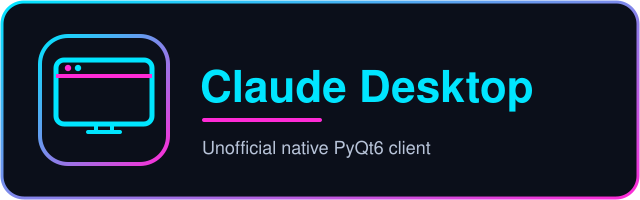

<div align="center">



# Claude Desktop

**An unofficial native PyQt6 desktop client for the Anthropic Claude API.**

<p>
  
  <a href="https://victorious-framework.pages.dev"></a>
</p>

</div>

---

This repository is a **Victorious Framework / Origin Source Labs** desktop chat app (`main.py`). It is **not** Anthropic's official Claude Desktop product and does not use or bundle Anthropic's official branding.

> **Status:** last commits are from 26 July 2026 (initial client, then streaming, sidebar, vision, copy, and character count). There is no CI, no test suite, and no published release. This README describes what is in the tree, not a claim that the app was re-tested today.

## Features (from the current source)

- Streaming replies through a background worker (`claude_desktop/worker.py`, `chat.py`).
- A left **sidebar** of conversations, with **New chat**, rename, and clear.
- **Settings** for API key, model, system prompt, thinking, effort, and max tokens.
- **Vision:** drag-and-drop an image onto the input box, or attach from a picker.
- Copy support and a character count (added in the follow-up commit).
- Keyboard shortcuts: `Ctrl+N` new chat, `Ctrl+L` clear current chat, `Ctrl+,` settings, `Enter` to send.

Model IDs currently listed in `claude_desktop/config.py` are `claude-opus-4-8`, `claude-sonnet-4-6`, and `claude-haiku-4-5`. Those are the strings in this repo; they are not independently verified here against Anthropic's live model catalog.

## Requirements

- Python 3
- Dependencies in `requirements.txt`: `anthropic>=0.40.0`, `PyQt6>=6.6.0`
- An Anthropic API key (stored locally, not in this repository)

The UI prefers the **JetBrains Mono** font, then Fira Mono, then Courier New.

## Run

```bash
python3 -m venv .venv
source .venv/bin/activate
pip install -r requirements.txt
python3 main.py
```

Settings and the API key are written to `~/.config/claude-desktop/config.json`. **Do not commit that file or paste keys into the repo.**

A `claude-desktop.desktop` launcher is included. Its `Exec=` path is hardcoded to `/home/origin/claude-desktop/main.py` and the icon is the generic `system-help` name, so it will need editing for another machine.

## Layout

| Path | What |
|---|---|
| `main.py` | Application entry point |
| `claude_desktop/window.py` | Main window, sidebar, shortcuts |
| `claude_desktop/chat.py` | Chat view, streaming, image attach |
| `claude_desktop/worker.py` | API streaming worker |
| `claude_desktop/config.py` | Local config load/save and model list |
| `claude_desktop/settings.py` | Settings dialog |
| `claude_desktop/style.py` | Qt stylesheet |

---

## Victorious fleet

Claude Desktop is a Victorious Framework / Origin Source Labs project by Don Victor. **Every app works standalone; fleet integrations are optional** and are not required by this client.

The fleet roster lives in [victorious-fleet](https://github.com/Victorious93/victorious-fleet). Site: [victorious-framework.pages.dev](https://victorious-framework.pages.dev).

## Contributing

Issues and pull requests are welcome. Keep changes focused, do not commit API keys or other secrets, and open a PR against `main`.

## License

**No license file is present in this repository.** Until one is added, default copyright remains with the author.
